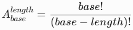
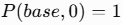

# Документация 
## Структуры данных и алгоритмы
### Состояние игры
Состояние игры представлено объектом GameState:

```
export interface GameState {
  secret: string;
  guesses: number;
}
```
Интерфейс GameState используется для определения структуры текущего состояния игры, объединяет данные, относящиеся к одной игровой сессии:
- secret — секретное число;
- guesses — количество сделанных попыток.
 Интерфейс позволяет легко расширять структуру данных, если в будущем возникнет необходимость добавить дополнительные свойства, например записывать историю попыток.

 ### Истории попыток

 Для хранения результатов завершённых игр используется массив.

Каждый результат представлен объектом GameResult:
```
export type GameResult = {
  id: string;
  guesses: number;
  duration: number;
  base: number;
  length: number;
  date: string;
};
```
Массив подходит для этой задачи, поскольку таблица лидеров представляет собой набор записей, которые необходимо отсортировать и ограничить десятью лучшими результатами.

Результаты сохраняются в localStorage в формате JSON, что позволяет им оставаться доступными после перезагрузки страницы.

### evaluateGuess

Функция evaluateGuess(secret, guess) сравнивает загаданное число с предположением игрока и возвращает количество «быков» и «коров».

Последовательность действий:
1. Из строк secret, guess получаем массивы символов в нижнем регистре secretArr и guessArr 
2. Символы из guessArr сравниваются с сиволами из secretArr на тех же позициях, совпавшие попадают в массив bull
3. С помощью createDigitValidator создается функция isInSecret, которая будет проверять наличие переданного символа в строке с секретом
4. С помощью isInSecret определяются символы из guessArr, которые есть в секрете, но они не должны находится на той же позиции что символы в secretArr. Символы соответствующие условиям формируют массив cows
5. Функция воозвращает число к «быков» и «коров», которые представляют собой длинну массивов bull и cows.

evaluateGuess использует filter() и createDigitValidator()

### countPossibleSecrets

Функция count Possible Secrets(length, base) вычисляет количество возможных секретных чисел, содержащих уникальные цифры.

У тебя реализована рекурсивная функция с мемоизацией. Для `DESIGN.md` я бы описала её следующим образом.

### 1.4. Алгоритм countPossibleSecrets

Функция countPossibleSecrets(length, base) вычисляет количество возможных секретных чисел заданной длины без повторяющихся символов в выбранной системе счисления.

Для вычисления используется рекурсивный алгоритм, основанный на формуле размещений без повторений:



Условие остановки рекурсии:



Алгоритм работает следующим образом:

1. Проверяется, не превышает ли длина секретного числа количество доступных символов. Если превышает, выбрасывается ошибка.
2. Если длина равна нулю, функция возвращает `1` — существует один вариант пустой строки.
3. Для каждой комбинации аргументов `length` и `base` формируется уникальный ключ кэша.
4. Проверяется наличие результата в `Map`. Если результат уже вычислялся, он возвращается из кэша.
5. Если результата в кэше нет, функция рекурсивно вычисляет количество вариантов для уменьшенных значений `length` и `base`.
6. Вычисленный результат сохраняется в `Map` и возвращается.

Для оптимизации используется мемоизация — сохранение ранее вычисленных результатов. Это позволяет избежать повторного выполнения одинаковых вычислений.

##
Теперь можно уточнить сложности `generateSecret` и `isValidGuess` по твоему реальному коду.

## Сложность алгоритмов (Big O)

- `n` — длина секретного числа;
- `b` — основание системы счисления, то есть количество доступных символов.

### `generateSecret`

- Временная сложность: O(n) — цикл выполняется до тех пор, пока `Set` не будет содержать `n` уникальных символов. Добавление элемента в `Set` занимает O(1) в среднем. Однако количество итераций зависит от случайных значений генератора.
- Пространственная сложность: O(n + b) — хранятся `Set` с выбранными символами размером до `n` и строка `notation` длиной `b`.

Уточнение: O(n) здесь — ожидаемая временная сложность при условии, что случайные значения равномерно распределены. В худшем случае цикл может не набрать нужное количество уникальных символов и завершиться по ограничению в 1000 попыток. Если учитывать это ограничение и считать `b` переменной, верхняя граница — O(1000 + b), то есть O(b).

### `evaluateGuess`

- Временная сложность: O(n) — выполняются два последовательных прохода по массиву символов с помощью filter(). Проверка допустимости символа имеет постоянную сложность, поскольку количество символов в системе счисления ограничено 16.

- Пространственная сложность: O(n) — создаются массивы символов и промежуточные массивы с результатами фильтрации.

### `isValidGuess`

- Временная сложность: O(n) — проверка длины выполняется за O(1), `every()` проходит по символам предположения, а `Set` проверяет уникальность символов. В среднем эти операции линейны относительно длины строки.
- Пространственная сложность: O(n) — создаются массив символов через `Array.from()` и `Set` для проверки уникальности.

### `countPossibleSecrets`

- Временная сложность: O(n) при первом вычислении — выполняется цепочка из `n` рекурсивных вызовов, каждый из которых делает постоянное количество операций.
- Временная сложность: O(1) в среднем при повторном вызове с теми же аргументами — результат извлекается из `Map` по ключу.
- Пространственная сложность: O(n) для одного вычисления — используется стек рекурсии глубиной до `n` и сохраняются промежуточные результаты в кэше.

Мемоизация позволяет избежать повторных вычислений для одинаковых аргументов.

Для раздела «Принципы чистого кода» в `DESIGN.md` лучше указать не просто названия принципов, а конкретные примеры из проекта `bulls-and-cows`: какой принцип применён, в каком файле и за счёт какого решения.

Ниже — вариант, основанный на коде функций, который мы уже разбирали.

## Принципы чистого кода

### 1. Осмысленные имена (Meaningful Names)

- `src/components/algorithms/generateSecret.ts` —переменные `uniqueChars`, `notation`, `attempts` описывают хранящиеся в них данные.
- `src/components/algorithms/evaluateGuess.ts` — имена `secret`, `guess`, `bulls`, `cows` соответствуют предметной области игры и позволяют понять назначение вычислений.

### 2. Принцип единственной ответственности (Single Responsibility Principle)

- `src/components/algorithms/generateSecret.ts` — `generateSecret()` отвечает за генерацию уникальной последовательности символов заданной длины.
- `src/components/algorithms/evaluateGuess.ts` — `evaluateGuess()` определяет количество быков и коров для переданной попытки.
- `src/components/algorithms/isValidGuess.ts` — `isValidGuess()` проверяет, соответствует ли введённая комбинация правилам игры.
- `src/components/algorithms/countPossibleSecrets.ts` — `countPossibleSecrets()` вычисляет количество возможных комбинаций.

Таким образом, каждая функция отвечает за отдельную операцию, а не содержит всю игровую логику в одном большом блоке.

### 3. KISS (Keep It Simple, Stupid)

- `src/components/algorithms/generateSecret.ts` — для хранения уникальных символов используется `Set`, поэтому не требуется вручную проверять каждый новый символ на наличие в уже собранной последовательности.
- `src/components/algorithms/isValidGuess.ts` — для проверки уникальности символов также используется `Set`. Сравнение `setOfGuess.size` с `guess.length` позволяет определить, есть ли повторяющиеся символы.
- `src/components/algorithms/evaluateGuess.ts` — для подсчёта быков и коров используются `filter()`, а не дополнительные циклы с ручным управлением счётчиками.

### 4. DRY (Don't Repeat Yourself)

- `src/components/algorithms/createDigitValidator.ts` — `createDigitValidator()` создаёт функцию проверки допустимости символа в выбранной системе счисления.
- `src/components/algorithms/isValidGuess.ts` — использует `createDigitValidator()` для проверки всех символов введённой комбинации.

Благодаря этому логика проверки допустимых символов не дублируется непосредственно в `isValidGuess()`.

### 5. Внедрение зависимостей

Зависимости передаются функции извне, а не создаются внутри неё. Это упрощает тестирование и позволяет управлять поведением функции.

\- `src/components/algorithms/generateSecret.ts` — функция `generateSecret(length, base, random = Math.random)` принимает генератор случайных чисел через параметр `random`.

В обычной работе используется `Math.random`, а в тестах можно передать собственную функцию, возвращающую заранее определённые значения. Это позволяет получать предсказуемые результаты и проверять генерацию без зависимости от случайности.
